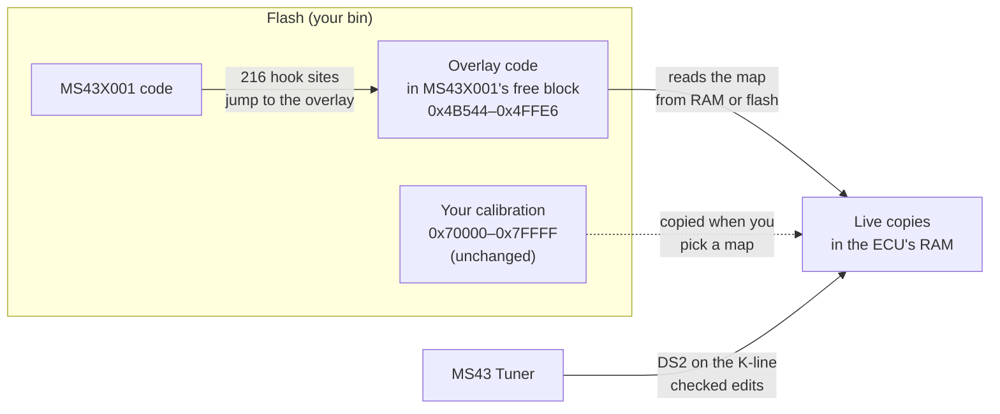

<div align="center">

# MS43X001 Custom

**MS43X001 with live tuning: change maps in the ECU while the engine runs, with no reflash.**

A code-only add-on to [MS43X001](https://github.com/ms4x-net/MS43X-Custom-Firmware), the MS4X project's custom
firmware for the Siemens MS43 (BMW M54).<br>
It lets [MS43 Tuner](https://github.com/raph559/MS43_TUNER) send maps and settings to the ECU's RAM over the
K-line, and adds pops & bangs on lift-off and an automatic downshift blip.

[](LICENSE)
[](overlay)
[-555.svg)](#compatibility)

[What it adds](#what-it-adds) · [How it works](#how-it-works) · [Build your bin](#build-your-bin) · [Compatibility](#compatibility) · [History](#history)

</div>

> [!WARNING]
> Experimental firmware. Every version ran in [MS43_EMULATOR](https://github.com/raph559/MS43_EMULATOR), which
> runs the real MS43X001 code, on scripted drives, and V10.x runs in one car (E46 M54B25). It has not been
> validated more widely. Keep your original bin, flash a build only if you can flash it back, and use the Fun
> features only on a closed road or a track.

## What it adds

| Feature | What it does |
|:---|:---|
| **Live maps** | Pick ignition, AFR target, VANOS, load and other maps (135 of them) in MS43 Tuner. The ECU copies them to RAM and reads them from there; your edits go over DS2 on the K-line. Switch between the edited and the flashed values at once to compare them. |
| **Live settings** | The rev limiter (rpm, hysteresis, fuel or ignition cut), and MS43X001's own launch control, no-lift shift and rolling anti-lag. |
| **Pops & bangs** | On lift-off in gear, holds off the overrun fuel cut for a set time with a late spark, a set AFR and a little throttle. Duration, angle, opening, AFR and the minimum rpm, coolant and speed are all settings. |
| **Downshift blip** | An automatic rev-match on braking downshifts, chosen per gear: the ECU opens the throttle toward the lower gear's rpm, with a spark cap above the target. |
| **Switch triggers** | Pops, the blip and the launch features can follow a switch in the car: cruise control armed, ASC off or A/C on. |
| **Map watch** | The ECU reports the exact cell it read in the map on the app's screen, for the app's live cursor. |

Everything is off until you turn it on in the app, and nothing you send survives a power cycle until you copy it
into the bin and flash it.

## How it works



- The overlay lives in flash space MS43X001 leaves erased. At each place the firmware reads a supported map, a
  hook jumps to the overlay, which reads the live copy in RAM when it is switched on and the flashed one otherwise.
- The app talks to it with one DS2 command. Every write is checked (session, revision, CRC-32, value limits) before
  the ECU uses it, and if the app goes silent the ECU goes back to the flashed values.
- The build writes code only: the overlay block, the hook sites and the five checksums. Your maps and settings
  stay exactly as they are; the build checks it byte by byte.

The full design, protocol and test records of each version are in [`docs/`](docs) and
[LIVE_OVERLAY.md](LIVE_OVERLAY.md).

## Build your bin

You need Python 3.10 or later and [AS](http://john.ccac.rwth-aachen.de:8000/as/) (Alfred Arnold's Macro
Assembler, `asl` and `p2hex`). On Windows without a native AS, the build runs it in WSL.

```bash
git clone https://github.com/raph559/MS43X001_CUSTOM.git
cd MS43X001_CUSTOM/overlay
python -I build_overlay.py path/to/your_ms43x001.bin
```

It writes `your_ms43x001-live-overlay-v10_2.bin` next to your bin, which it only reads. Flash the result with MS4X
Flasher, then open it in MS43 Tuner: the Live tuning and Fun tabs find the overlay. The options and every check
the build makes are in [overlay/README.md](overlay/README.md).

The build refuses a bin whose program is not a supported MS43X001, a bin that is already patched, and any write
outside the overlay block and the hook sites.

## Compatibility

| Firmware | Status |
|:---|:---|
| MS43X001, October 2025 release, M54B25 | Supported (program identity `32141e63…0d35`) |
| Other MS43X001 variants (B22, B30, other releases) | Refused until their program is checked: the hooks would land on the wrong code |
| Stock MS430069 family | Not supported |

The calibration can be anything: your own tune is kept as it is.

## History

This repository keeps the overlay's real development history from the author's lab, 71 commits from the first
patch to V10.2.

| Version | Added |
|:---|:---|
| V2–V3 | Live ignition and VE maps in RAM, full-copy CRC-32, edits in checked groups |
| V4–V5 | A catalogue of 124 maps to choose from, the rev limiter, maps allocated from free RAM |
| V6 | Launch control, no-lift shift and rolling anti-lag settings |
| V7 | 11 more maps with 16-bit values |
| V8–V8.5 | Pops & bangs on lift-off |
| V9 | The map watch and the switch triggers |
| V10–V10.2 | The downshift blip with its spark cap, and real AFR targets for pops |

| Path | What |
|:---|:---|
| [`overlay/`](overlay) | **The current version (V10.2) and its code-only build.** Start here. |
| [`patches/`](patches) | Every version's assembly, as it was developed |
| [`tools/`](tools) | The lab's generators and builders for each version |
| [`docs/`](docs), [`LIVE_OVERLAY.md`](LIVE_OVERLAY.md), [`OVERLAY_BUILD.md`](OVERLAY_BUILD.md) | Each version's design, protocol and test records |

The lab builders in `tools/` read the author's own bins, which are not published; use `overlay/build_overlay.py`.
`patches/overlay.asm`, the very first patch, is a known-bad record: never build or flash it.

## Contributing

Reports from other cars are very welcome, and so is help supporting more MS43X001 variants; see
[CONTRIBUTING.md](CONTRIBUTING.md). Never attach a bin to an issue: give its firmware and SHA-256.

## License

GPL-3.0-only ([LICENSE](LICENSE)), as a modification of MS43X001 by the MS4X project
([MS43X-Custom-Firmware](https://github.com/ms4x-net/MS43X-Custom-Firmware), GPL-3.0). MS43X001 is built on
Siemens's MS430069 software, which is not part of this repository. No bin is published.
